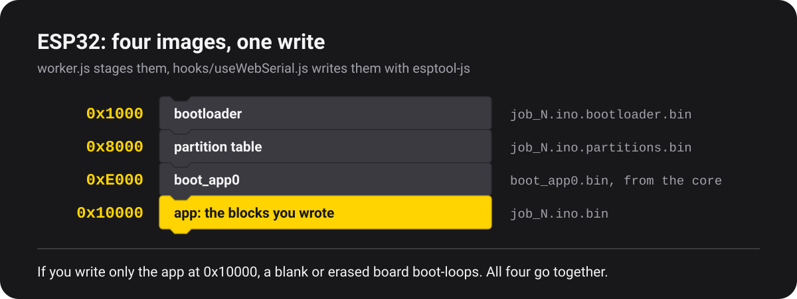
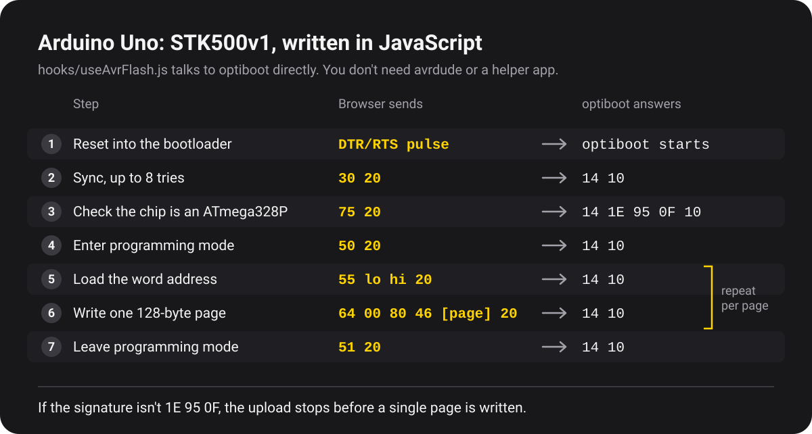

<p align="center">
  
</p>

<p align="center">
  <a href="https://aurigen-apps.vercel.app"><b>Open the editor</b></a>
  &nbsp;·&nbsp;
  <a href="#from-block-to-board">From block to board</a>
  &nbsp;·&nbsp;
  <a href="#run-it-yourself">Run it yourself</a>
</p>

Aurigen is the block-coding app from Aurigen, a robotics learning company. You snap Blockly blocks together, watch your program run on a simulated board, then flash a real ESP32 DevKit V1 or Arduino Uno R3 over USB. You don't install an IDE or a toolchain. Your browser generates the C++, a server compiles it with `arduino-cli`, and Web Serial writes it to the chip. Some laptops still need the board's USB serial driver (CP2102 or CH340), and that's all.

## From block to board

<p align="center">
  
</p>

1. **Blocks become C++ in your browser.** Blockly doesn't ship a C++ generator, so `blockly/cppGenerator.js` is a custom one. It hoists `#include` lines and globals to the top of the sketch and `pinMode` calls into `setup()`, and the pin menus only list pins that are safe on the board you picked.
2. **The API checks who's asking.** `POST /api/compile` verifies your Supabase JWT, allows 6 compiles per user per minute, rejects sources over 256 KB, and maps the board key (`esp32` or `uno`) to an FQBN on the server, so a client can't pick its own. It answers `202` with a job id.
3. **BullMQ queues the job on Redis.** Once 50 jobs are waiting or running, the API returns `503` instead of letting the queue grow.
4. **`arduino-cli` builds it.** `backend/worker.js` writes the sketch to disk and runs `arduino-cli compile` through `execFile`, with no shell and a 180 s timeout. If the build fails, you get the last 15 error lines, not the whole build log.
5. **Your browser collects the images.** The editor polls `/api/status/:jobId` every 1.5 s, and only the user who submitted a job can poll it. Each artifact URL carries a random token, and the server deletes the file after 10 minutes.
6. **Web Serial writes the flash.** On the ESP32, esptool-js toggles DTR and RTS to enter download mode, so you never press BOOT. It writes all four images and resets the board. On the Uno, a hand-written STK500v1 programmer does the same job.

## What else is in it

- **Two simulators, one contract.** The block interpreter (`simulator/interpreter.js`) runs any board while you edit. The firmware engine (`simulator/engines/avrEngine.js`) runs the real compiled `.hex` on a simulated ATmega328P with [avr8js](https://github.com/wokwi/avr8js): timers, USART serial, the ADC, and PWM brightness measured from CPU cycles. Both emit `{ pins, serial, running, txCount }`, so `components/Simulator.jsx` doesn't care which one it's driving.
- **No sign-up wall.** You can build, simulate and save to `localStorage` as a guest. Only cloud compile asks for an account, and your guest projects move into it the first time you sign in (`auth/AuthProvider.jsx`).
- **Isolation in the database.** Row Level Security policies in Supabase Postgres, not app code, keep your projects out of other accounts (`supabase/migrations/001_init.sql`).
- **Share links with no upload.** `lib/share.js` packs the workspace XML into the URL hash, so a shared program never touches a server.
- **Seven starter programs** in `lib/examples.js`: Blink, a button, a breathing LED and a WiFi hello on the ESP32; Blink, a button and knob-to-brightness on the Uno.

## Two boards, two flash paths

<p align="center">
  
</p>

The worker exports all four ESP32 images, not only the app. Flashing just the app at `0x10000` only works if a matching bootloader and partition table are already on the chip; a factory-fresh or erased DevKit boot-loops without them. Sending all four adds about 3 s to the flash, and the first boot is the same every time. Some core versions don't produce `boot_app0.bin`. The worker skips it, and a three-image export is normal.

<p align="center">
  
</p>

We couldn't find a JavaScript STK500 library that fit, so `hooks/useAvrFlash.js` speaks the protocol to optiboot itself: an auto-reset through DTR, a sync with up to 8 retries, a signature check that refuses anything but an ATmega328P, then 128-byte page writes. If your browser doesn't have Web Serial, you get a `.hex` or `.bin` download instead.

| | ESP32 DevKit V1 | Arduino Uno R3 |
|---|---|---|
| Chip | ESP-WROOM-32 | ATmega328P |
| FQBN | `esp32:esp32:esp32` | `arduino:avr:uno` |
| Digital pins offered | GPIO 16, 17, 25, 26, 27, 32, 33 (strapping pins 0, 2, 5, 12, 15 left out) | D2 to D13 (D0 and D1 stay free for serial) |
| Analog in | GPIO 32, 33, 34, 35, 36, 39 (ADC1 only, ADC2 clashes with WiFi), 0 to 4095 | A0 to A5, 0 to 1023 |
| PWM | LEDC at 5 kHz, 8-bit, channels assigned in a fixed order | `analogWrite` on D3, D5, D6, D9, D10, D11 |
| WiFi block | Yes | No |
| Flashing | esptool-js, four images | STK500v1 to optiboot |
| Simulator | Block interpreter | Block interpreter and avr8js firmware engine |

If you want another board, it's one entry in `frontend/src/boards/boards.js` plus an SVG of the board. A new simulator engine is one class that emits the same state shape.

## Run it yourself

### Try it in the browser

Open [aurigen-apps.vercel.app](https://aurigen-apps.vercel.app) in desktop Chrome or Edge. You can build, simulate and save without an account.

> The compile service runs on a self-hosted machine behind a Cloudflare quick tunnel right now, so cloud compile and flashing only work while that machine's up. The editor and the block simulator don't need it. [HANDOVER.md](HANDOVER.md) covers the move to a permanent host.

### Frontend

```bash
cd frontend
npm install
cp .env.example .env   # VITE_SUPABASE_URL, VITE_SUPABASE_ANON_KEY, VITE_COMPILE_API
npm run dev            # http://localhost:5173
```

`npm test` runs the Vitest suite, `npm run lint` runs ESLint, and `npm run build` writes `frontend/dist`.

### Database

Apply `supabase/migrations/001_init.sql` in the Supabase SQL editor, or run `supabase db push`.

### Compile backend with Docker

You don't need a VPS, a signup or a card:

```bash
cp backend/.env.example backend/.env   # fill in SUPABASE_URL + SUPABASE_SERVICE_ROLE_KEY
docker compose up -d --build           # builds arduino-cli + both cores into the image
docker compose logs -f                 # watch server.js + worker.js
```

This runs Redis, the API and the worker in containers (`docker-compose.yml`, `backend/Dockerfile`). Point `VITE_COMPILE_API` at `http://localhost:4000` while you test locally. After you edit `backend/.env`, run `docker compose up -d --force-recreate api worker`; a plain restart keeps the old values.

To reach it from a deployed frontend, expose it with a free [Cloudflare Tunnel](https://developers.cloudflare.com/cloudflare-one/connections/connect-networks/get-started/):

```bash
winget install --id Cloudflare.cloudflared   # or: choco install cloudflared
cloudflared tunnel --url http://localhost:4000
```

That prints an `https://<random>.trycloudflare.com` URL. Set it as `VITE_COMPILE_API` in the frontend. It only answers while your machine and the tunnel are running, and it changes on every restart, so it's fine for demos but not for uptime. For a stable URL on your own domain, use a named tunnel (`cloudflared tunnel create` + `cloudflared tunnel route dns`).

<details>
<summary><b>Oracle Cloud "Always Free" VPS</b> (4 vCPU / 24 GB RAM ARM shape, no expiry)</summary>

1. Sign up at [cloud.oracle.com](https://cloud.oracle.com) and create a Compute instance: shape **VM.Standard.A1.Flex**, image **Ubuntu 22.04**, your SSH key.
2. Open ingress on TCP 443 (and 80 for Let's Encrypt) in the instance's Security List.
3. SSH in and run the provisioning script that's in this repo:
   ```bash
   git clone https://github.com/https-shubhamsahu/aurigen_apps_block_programming.git aurigen
   cd aurigen/backend
   chmod +x install.sh && ./install.sh
   ```
   It installs Redis, Node 22, python3, `arduino-cli` and the ESP32 and AVR cores, runs `npm install` for the backend, and starts `server.js` and `worker.js` under **pm2** (`ecosystem.config.cjs`) so they survive reboots.
4. Edit `backend/.env` with your real `SUPABASE_SERVICE_ROLE_KEY` and `CORS_ORIGIN`, then `pm2 restart all`.
5. Point a subdomain at the instance's public IP and put Caddy in front for automatic HTTPS (the `Caddyfile` is included). If you don't have a domain, use a Cloudflare Tunnel instead (systemd unit template in `cloudflared.service.example`) for HTTPS with no open ports.

</details>

<details>
<summary><b>Manual install on any VPS</b></summary>

```bash
# Redis
sudo apt install redis-server && sudo systemctl enable --now redis-server

# arduino-cli + ESP32 core (one-time, ~10 min)
curl -fsSL https://raw.githubusercontent.com/arduino/arduino-cli/master/install.sh | sh
export PATH=$PATH:$PWD/bin
arduino-cli config init
arduino-cli config add board_manager.additional_urls \
  https://raw.githubusercontent.com/espressif/arduino-esp32/gh-pages/package_esp32_index.json
arduino-cli core update-index
arduino-cli core install esp32:esp32
arduino-cli core install arduino:avr   # Arduino Uno R3 target

# App
cd backend
npm install
cp .env.example .env   # fill in secrets
node server.js         # API (use pm2/systemd in production)
node worker.js         # compile worker (separate process)
```

The ESP32 core's build scripts need `python3`, and supabase-js needs Node 22 or newer. `install.sh` installs both; on a manual setup you'll have to check them yourself.

</details>

### Backend environment

| Variable | Default | What it does |
|---|---|---|
| `PORT` | `4000` | API port |
| `REDIS_URL` | `redis://127.0.0.1:6379` | BullMQ connection |
| `SUPABASE_URL`, `SUPABASE_SERVICE_ROLE_KEY` | none, required | Verifies user JWTs (server-side only) |
| `CORS_ORIGIN` | `*` | Comma-separated list of allowed frontend origins |
| `ARTIFACT_DIR`, `JOB_DIR` | `/tmp/aurigen-artifacts`, `/tmp/aurigen-jobs` | Where images are staged and sketches are built |
| `ARDUINO_CLI` | `arduino-cli` | Path to the binary |
| `FQBN` | `esp32:esp32:esp32` | Fallback board for jobs without one |
| `CONCURRENCY` | `2` | Parallel compiles per worker |
| `RATE_MAX_PER_WINDOW`, `RATE_WINDOW_MS` | `6`, `60000` | Per-user compile limit |
| `MAX_QUEUE_DEPTH` | `50` | Waiting plus active jobs before the API answers `503` |
| `MAX_SOURCE_BYTES` | `262144` | Largest sketch the API accepts |
| `COMPILE_TIMEOUT_MS` | `180000` | Kill a compile after this long |
| `ARTIFACT_TTL_MS` | `600000` | How long staged images stay downloadable |

## Stack

| Layer | Technology |
|---|---|
| Frontend | React (Vite), Blockly, esptool-js |
| Backend | Node.js, Express, BullMQ |
| Compile worker | `arduino-cli` (ESP32 + AVR cores) |
| Queue | Redis |
| Auth / DB | Supabase (Auth, Postgres, Row Level Security) |
| Simulation | Custom block interpreter + avr8js (AVR firmware simulation) |
| CI | GitHub Actions: frontend lint, test and build; backend `node --check` |

## Project structure

```
frontend/src/auth/AuthProvider.jsx           Session context + requireAuth + guest→cloud migration
frontend/src/auth/AuthModal.jsx              On-demand sign-in (never a wall)
frontend/src/lib/localProjects.js            Guest persistence (localStorage, cloud-shaped rows)
frontend/src/lib/supabaseClient.js           Supabase client + auth/project helpers
frontend/src/lib/share.js                    Share-by-URL codec
frontend/src/blockly/cppGenerator.js         Custom Blockly → C++ generator core
frontend/src/blockly/esp32Blocks.js          Board-aware block defs + generators
frontend/src/boards/boards.js                Board registry: pins, ADC range, FQBN, flash method
frontend/src/simulator/interpreter.js        Blocks engine (instant, all boards)
frontend/src/simulator/engines/avrEngine.js  Firmware engine (avr8js, Uno only)
frontend/src/simulator/hex.js                Intel HEX parser (engine + flasher)
frontend/src/hooks/useWebSerial.js           ESP32 flashing (esptool-js)
frontend/src/hooks/useAvrFlash.js            Uno flashing (STK500v1 over Web Serial)
backend/server.js                            Express API + BullMQ producer + rate limits
backend/worker.js                            BullMQ consumer → arduino-cli
supabase/migrations/001_init.sql             Tables + RLS
scripts/build_readme_assets.py               Rebuilds the SVGs in assets/readme/
```

## Limits

- The block interpreter is the only ESP32 simulator. There's no open-source ESP32 core to embed, so the firmware-accurate engine is Uno-only.
- The firmware engine runs on the main thread in 6 ms slices. A Web Worker would take it off the main thread; that hasn't been done yet.
- USB flashing needs Web Serial, so you'll need desktop Chrome or Edge. Other browsers get the compiled file as a download.
- CI only syntax-checks the backend (`node --check`). There's no backend test suite and no live Redis or Supabase in CI, so you'll only catch `server.js` and `worker.js` bugs by running the stack.
- Guest projects live in one browser's `localStorage` until you sign in.

## Contributing

Fork the repo, create a feature branch and open a pull request. If you're adding a board, follow the `boards/boards.js` + simulator-engine contract above. [HANDOVER.md](HANDOVER.md) has the live deploy state and the ops runbook.

## License

No license file is currently present in this repository.

---

Built by [Shubham Sahu](https://github.com/https-shubhamsahu) for Aurigen. Contact: shubhamsahu@nosus.foo
